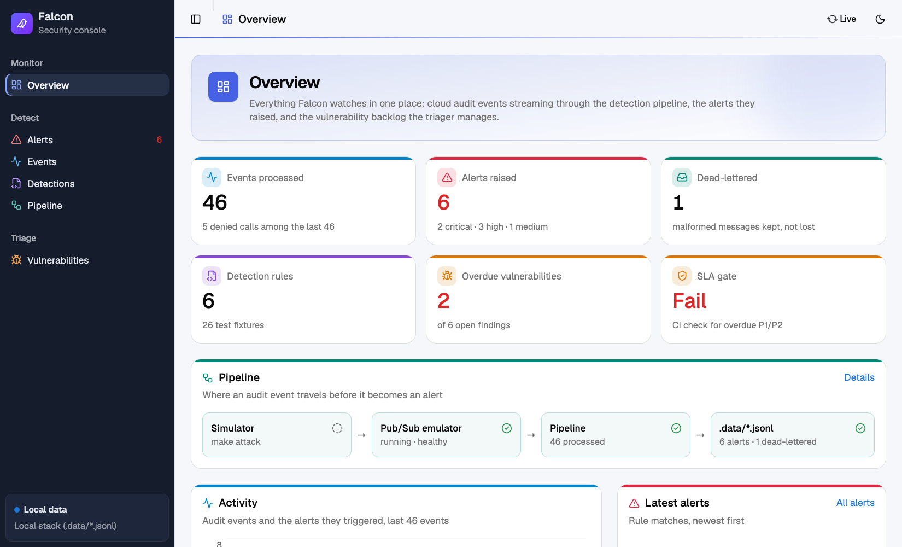

#  Falcon

Security observability and vulnerability automation for Google Cloud, engineered as code.

Falcon does two jobs a small product security team should not do by hand:

1. **Detect**: stream GCP audit logs through a Go pipeline that normalizes them, runs
   detection rules written as tested YAML, stores everything in BigQuery and alerts on Slack.
2. **Triage**: pull Dependabot and code-scanning alerts across npm, Maven, Go and Python
   repos, prioritize them by real-world exploitability, route them to the owning team, and
   nudge until they are fixed.

Everything runs locally with one command, and deploys to GCP with Terraform and keyless CI.

<p align="center">
  
</p>

In the detect lane, blue dots are ordinary audit events streaming into BigQuery. Every few
seconds a **red** event (a rule match) lights up the detection stage and is routed to Slack,
and an **amber** malformed message is set aside in the dead-letter topic instead of being lost.

## Why Falcon

Most cloud breaches today don't start with malware. They start with an **ordinary API call
made by the wrong identity**: a phished session, a leaked service account key, or an engineer
in a hurry who makes a bucket public "just for a minute". GCP records every one of those calls
in its audit logs, but logs nobody reads are not detection. Attackers know this, which is why
one of their first moves is often to switch the logging off.

The second problem is the opposite: too many alerts. Dependabot and code scanning open
hundreds of findings across npm, Maven, Go and Python repos. Ranked by CVSS alone, a large
share of them look "critical", nobody is clearly responsible for them, and the one that is
actually being exploited in the wild gets lost among the rest.

A small product security team can't watch logs or sort vulnerabilities by hand. Falcon turns
both jobs into software, so they get the same treatment as the product:

- **Code-reviewed**: detections, infrastructure and scoring rules live in Git and change through pull requests.
- **Tested**: every rule has should-fire and should-not-fire fixtures, and CI blocks a broken rule.
- **Reproducible**: the whole stack is Terraform, deployed with keyless CI, and runs locally in Docker.
- **Quiet by design**: alerts go out only for things worth a person's time, and every alert or issue explains why it exists.

## Who uses it

| Who | What they get from Falcon |
|---|---|
| **Security engineers** (the owners) | Write detection rules in YAML with tests, run and tune the pipeline, and decide the scoring policy and SLAs. |
| **On-call responders** | A Slack alert with severity, actor, resource, MITRE ATT&CK technique and a runbook link, plus every audit event in BigQuery for the "what else did this account do?" query. |
| **Product engineering teams** | One GitHub issue per vulnerability worth fixing, routed to the owning team through CODEOWNERS, with the score explained, a due date, and a reminder if it slips. Low-value findings stay out of their tracker. |
| **Engineering leads** | The triage report shows what is open, by priority and owner, and what is overdue. The SLA gate in CI turns red while P1/P2 findings are late. |
| **Auditors** (ISO 27001, SOC 2) | Evidence: retained audit logs, documented detections and runbooks, a written remediation SLA, and infrastructure whose every change went through review. |

## What Falcon finds and alerts on

### Threats in the cloud account (detect lane)

An attacker is not always a stranger. Falcon is built for four kinds:

- **External attackers** who phished or stole a login.
- **Malicious insiders** who already have legitimate access.
- **Hijacked machine identities**, such as a CI pipeline taken over by a poisoned dependency.
- **Careless engineers** with no bad intent, whose shortcut opens the same hole an attacker would.

None of them needs malware. They all call ordinary Google APIs, and every one of those calls lands in Cloud Audit Logs.

<p align="center">
  
</p>

Each row is a rule in [`detections/rules/`](detections/rules/), triggered by a real GCP audit log event.

| Severity | Alert | What happened | Why it matters | ATT&CK |
|---|---|---|---|---|
| Critical | `gcp-audit-logging-tampered` | A log sink, log bucket or exclusion was deleted or changed, or a log was deleted | An attacker is trying to blind detection, and Falcon itself depends on this sink | T1562.008 |
| Critical | `gcp-bucket-made-public` | `allUsers` or `allAuthenticatedUsers` was granted access to a Cloud Storage bucket | Anything in the bucket can now be downloaded by anyone on the internet: a data leak | T1530 |
| High | `gcp-privileged-role-granted` | `owner`, `editor`, security admin, org admin, or a role that can mint service account credentials was added to a principal | Privilege escalation or a backdoor account, often granted to an outside address | T1098.003 |
| High | `gcp-sa-key-created` | A long-lived key was created for a service account | Keys are easy to steal and live forever; Falcon's own CI uses keyless Workload Identity, so any new key needs a reason | T1098.001 |
| High | `gcp-firewall-open-to-internet` | An ingress firewall rule was created or changed to allow `0.0.0.0/0` | SSH, RDP or a database is exposed to the whole internet | T1562.007 |
| Medium | `gcp-secret-accessed-by-human` | A person (not a workload) read a Secret Manager secret value | Workloads read secrets, people rarely should; it may be a compromised account harvesting credentials | T1555 |

Just as important is what does **not** alert: denied attempts, keys being deleted, public
access being removed, egress-only or internal firewall rules, a viewer role being added, and
workloads reading secrets through service accounts. Each of these near-misses is a
`should_not_fire` fixture, so a later change can't quietly make a rule noisy, and `make attack`
adds 40 benign events such as CI deploys that must stay silent. Every alert links to a section of
[docs/runbooks.md](docs/runbooks.md) with how to triage, contain and prevent it.

### Vulnerabilities in the code (triage lane)

| Source | What it covers | Example from the demo |
|---|---|---|
| Dependabot alerts | Known CVEs in third-party dependencies (npm, Maven, Go, pip) | Log4Shell in `log4j-core`, HTTP/2 Rapid Reset in `golang.org/x/net`, template injection in `jinja2` |
| Code scanning (CodeQL) | Flaws in the team's own code | SQL injection (`js/sql-injection`) |

Falcon doesn't just count these. It ranks each one by how likely it is to hurt you:

- **Severity**: CVSS score.
- **Likelihood of exploitation**: the EPSS probability from FIRST.
- **Exploited right now**: listed in the CISA Known Exploited Vulnerabilities catalog. A KEV finding in runtime code is always P1.
- **Exposure**: first-party code ranks higher; a development-only dependency counts half.

The result is a P1 to P4 priority with a fix deadline (7, 30, 90 or 180 days). Falcon raises,
updates, nudges and closes GitHub issues to match.

## Try it in five minutes

Requirements: Go 1.25+, Node 22.18+, Docker. Terraform is only needed for `make tf-check`.

```bash
make test         # all unit tests and detection fixtures, no Docker
make up           # Pub/Sub emulator + pipeline in Docker, push subscription wired
make attack       # replay an attack story through the real pipeline and verify it
make triage-demo  # triage recorded GitHub alerts, no token needed
make down         # stop and clean up
```

`make help` lists every target.

### See it all in the console

```bash
make console      # web UI on http://localhost:5173, reads the local stack (.data/)
make console-gcp  # the same UI on the deployed project's live data
```

<p align="center">
  
</p>

The console is a React + shadcn/ui app with a small Node API (`console/server`). Its pages:

| Page | Shows |
|---|---|
| **Overview** | Counters, pipeline health, activity over time, latest alerts, the vulnerability backlog |
| **Alerts** | Every rule match. Opening one shows the actor, resource, detection latency, the runbook, and the triggering event both normalized and as the original audit log |
| **Events** | All normalized events, searchable and filterable, plus the dead-letter queue |
| **Detections** | The rules with their YAML, fixtures and how often each fired. **Run fixture tests** runs `detect test` from the browser |
| **Vulnerabilities** | The triage plan: priority, score and why, owners, due dates, the planned issue action, and the SLA gate |
| **Pipeline** | The live state of each stage. On GCP: log sink, Pub/Sub subscription, Cloud Run revision and ingress, BigQuery counts and Terraform outputs. Locally: containers and pipeline counters |

In GCP mode the API reads BigQuery and the Cloud Run, Logging and Pub/Sub APIs using your
`gcloud` login, and finds the project from the Terraform outputs. It only listens on
localhost. Those BigQuery reads are themselves audit-logged back into Falcon, so the console
caches responses for 30 seconds and refreshes once a minute in this mode. Your login may hold
far more access than the console needs, so use a read-only account for anything beyond a local
demo. The triager
runs on the demo data unless `TRIAGE_REPOS` and `GITHUB_TOKEN` are set; then it does a
read-only live run.

### What happens when an attacker acts

<p align="center">
  
</p>

The near miss in step 6 matters as much as the hit. A rule that alerts on denied attempts
pages people for nothing, and an alert-fatigued team misses the real one. Every rule ships with
`should_not_fire` fixtures for exactly these cases.

### What `make attack` shows

The simulator plays a compromised account working through a cloud kill chain. It mixes in
40 benign events, including near-misses that a sloppy rule would flag, plus one malformed
message. It then reads what the pipeline wrote and **fails if any step is missed, any benign
event alerts, or the poison message is lost**:

```
Attack story (mallory@corp.example, phished session from 203.0.113.66):
  1. Read the Stripe API key from Secret Manager                expect gcp-secret-accessed-by-human
  2. Create a key for the CI deployer service account           expect gcp-sa-key-created
  3. Grant roles/owner to an external Gmail account             expect gcp-privileged-role-granted
  4. Open SSH (tcp:22) to 0.0.0.0/0                             expect gcp-firewall-open-to-internet
  5. Make the customer-exports bucket public                    expect gcp-bucket-made-public
  6. Delete the audit log sink that feeds Falcon                expect gcp-audit-logging-tampered
  + 40 benign events (CI deploys, reads, harmless IAM changes, denied attempts)
  + 1 poison message (not a LogEntry)

Alerts raised:
  [CRITICAL] gcp-audit-logging-tampered       actor=mallory@corp.example  mitre=T1562.008
  [CRITICAL] gcp-bucket-made-public           actor=mallory@corp.example  mitre=T1530
  [HIGH    ] gcp-firewall-open-to-internet    actor=mallory@corp.example  mitre=T1562.007
  [HIGH    ] gcp-privileged-role-granted      actor=mallory@corp.example  mitre=T1098.003
  [HIGH    ] gcp-sa-key-created               actor=mallory@corp.example  mitre=T1098.001
  [MEDIUM  ] gcp-secret-accessed-by-human     actor=mallory@corp.example  mitre=T1555

Pipeline stats: {"alerts":6,"dead_lettered":1,"duplicates":0,"errors":0,"processed":46,"rules":6}
Detected 6/6 attack steps, 0 false positives on 40 benign events, poison message dead-lettered: true
PASS: end-to-end check succeeded
```

Afterwards, `make alerts` prints the stored alerts and `make logs` follows the pipeline.
The raw output is in `.data/{events,alerts,deadletter}.jsonl`.

### What `make triage-demo` shows

```
PRI  SCORE  REPO                ALERT   PACKAGE                                      CVE             OWNERS                    DUE                    ACTION
P1   98     acme/payments-api   dep#14  org.apache.logging.log4j:log4j-core (maven)  CVE-2021-44228  @acme/ledger-team @alice  2026-10-22 (7d late)   create issue in acme/payments-api
P1   84     acme/data-platform  dep#4   golang.org/x/net (go)                        CVE-2023-44487  @acme/ingest-team         2026-09-08 (51d late)  nudge #57
P2   47     acme/payments-api   code#3  js/sql-injection (code)                      -               @acme/checkout-team       2026-11-19             create issue in acme/payments-api
P3   29     acme/payments-api   dep#12  lodash (npm)                                 CVE-2021-23337  @acme/checkout-team       2026-12-19             update #102 (P2 -> P3)
P3   22     acme/data-platform  dep#6   jinja2 (pip)                                 CVE-2024-22195  @acme/analytics           2027-01-08             create issue in acme/data-platform
P4   15     acme/payments-api   dep#15  braces (npm)                                 CVE-2024-4068   @acme/platform            2027-03-30             report only (below issue threshold)

close acme/payments-api#101: alert is fixed
```

Each issue lifecycle path appears in the demo: create, re-prioritize, nudge an overdue
owner, close a fixed one, and keep low-value noise out of the issue tracker.
`make triage-check` is the CI gate; it exits 1 here because two P1s are past their SLA.

The demo data lives in `triager/test/fixtures/demo`. The alerts mirror real advisories;
the EPSS numbers are illustrative snapshots.

## Components

### 1. Infrastructure (`infra/terraform`)

| Module | What it does | Security decisions |
|---|---|---|
| `log-sink` | Project sink for all Cloud Audit Logs to Pub/Sub; enables Data Access logs for Secret Manager | The sink's own writer identity can publish to one topic only |
| `pubsub` | Topic, push subscription with OIDC auth, dead-letter topic and pull subscription | Push identity is a dedicated SA; retries back off from 10s to 600s |
| `pipeline-run` | Cloud Run service | **Internal ingress only**; only the push SA holds `run.invoker`; Slack webhook comes from Secret Manager |
| `bigquery` | `events`, `alerts` and `deadletter` tables, partitioned and clustered, with retention | Pipeline SA gets `dataEditor` on this dataset only, not the project |
| `ci-identity` | Workload Identity Federation for GitHub Actions and a deployer SA | **No SA keys.** Trust is pinned to `repo:<owner>/<repo>:ref:refs/heads/main`; every grant is resource-scoped |

`make tf-check` runs `terraform fmt`, `terraform validate`, tflint and Checkov. Checkov passes.
Its skips are documented inline and cover CMEK, which is out of scope for a demo.

Deploy (optional):
```bash
cd infra/terraform/envs/dev
cp terraform.tfvars.example terraform.tfvars   # set project_id, github_repository
terraform init && terraform apply
terraform output github_actions_variables      # add these as repository variables
```
Terraform needs Google credentials, for example from `gcloud auth application-default login`.
Set `deletion_protection = false` in `terraform.tfvars` for a test project, so that
`terraform destroy` can remove everything later.

The first apply runs a placeholder image. Once the repository variables are set, every push to
`main` that touches `pipeline/` or `detections/` builds and rolls out a new revision through
`.github/workflows/deploy.yml`. Before that, or from a fork, deploy by hand from the repo root:
```bash
REPO=$(terraform -chdir=infra/terraform/envs/dev output -raw image_repository)
TAG=manual-$(date +%Y%m%d-%H%M%S)   # tags in this repository are immutable
gcloud auth configure-docker europe-north1-docker.pkg.dev
docker build --platform linux/amd64 -f pipeline/Dockerfile -t $REPO/pipeline:$TAG .
docker push $REPO/pipeline:$TAG
gcloud run services update falcon-pipeline --region europe-north1 --image $REPO/pipeline:$TAG
```

Falcon has been run end to end on a real GCP project: making a bucket public raised
`gcp-bucket-made-public` 1.6 seconds after the audit event, with no false positives from the
real events around it. That test covered this one rule. The other five are verified by their
fixtures and the local attack replay.

To remove a deployment, run `terraform destroy`. GCP keeps a deleted Workload Identity pool for
about 30 days, so a new apply in that window can fail on the `github` pool until it is
undeleted and imported, or given another name. The live demo is not kept running, to avoid
idle cost.

### 2. Log pipeline (`pipeline/`, Go)

`POST /pubsub/push` → **normalize** (LogEntry to a flat event schema, plus enrichment:
actor type, IP class, IAM binding deltas) → **detect** → **sink** (BigQuery or JSONL)
→ **notify** (console, Slack).

Delivery semantics, which the tests cover:

| Situation | Response | Why |
|---|---|---|
| Processed | `204` | Ack |
| Malformed message | Write to `deadletter`, then `204` | A retry can never succeed, so the message is acked, but it is kept |
| Sink (BigQuery) failure | `500` | Pub/Sub retries; after 5 attempts the message goes to the dead-letter topic |
| Redelivered event | `204`, skipped | Bounded dedup cache keyed on `insertId`, which is also the BigQuery insert ID |
| Slack failure | Logged | The alert is already persisted; one message's alerting must not block the stream |

`GET /stats` reports counters; `GET /healthz` is the health check.

### 3. Detections as code (`detections/`)

Six rules, each mapped to MITRE ATT&CK. Each must ship with fixtures that should and
should not fire. See [detections/README.md](detections/README.md) for the rule language.

```bash
make detect-test                                    # 26 fixtures, CI gate
cd pipeline && go run ./cmd/detect run ../detections/tests/gcp-sa-key-created/should_fire/user-creates-key.json
```

The rules are checked three times: by `go test`, by `detect test` in CI, and inside the Docker
build. An image with a broken rule cannot be built.

### 4. Vulnerability triager (`triager/`, TypeScript)

<p align="center">
  
</p>

The score runs from 0 to 100, and every point is explained in the issue:

| Signal | Points |
|---|---|
| CVSS × 4 | up to 40 |
| EPSS exploit probability × 30 | up to 30 |
| In CISA KEV | +30, and always P1 if runtime |
| First-party code (code scanning) | +15 |
| Development-only dependency | × 0.5 |

P1 ≥ 70 (7-day SLA), P2 ≥ 40 (30 days), P3 ≥ 20 (90 days), otherwise P4 (180 days, report only).
Owners come from CODEOWNERS (last match wins), with a fallback to `@acme/security`.

Issue state is kept in hidden markers in the issue body, so there is no database and re-runs are
idempotent. Issues are closed when the alert is fixed, reopened if someone closes one while the
alert is still open, and never touched for repos that weren't scanned.

```bash
make triage REPO=you/some-repo DRY_RUN=1   # live, read-only (needs GITHUB_TOKEN)
make triage REPO=you/some-repo             # live, creates and updates issues
```

Daily runs go through `.github/workflows/triage.yml`. Its last step is the SLA gate, and it
goes red while P1/P2 findings are overdue. The same command can gate a product repo's own CI:
```bash
node triager/dist/cli.js check --repo <owner/name> --max-priority P2
```

## Architecture

[docs/architecture.html](docs/architecture.html) describes every part, its technology, how the parts connect and how data moves between them. GitHub shows HTML as source, so download the file or open it from a clone.

## Repository layout

```
infra/terraform/   modules/ (log-sink, pubsub, pipeline-run, bigquery, ci-identity), envs/dev
pipeline/          Go: cmd/pipeline (service), cmd/detect (rule CLI), internal/*
detections/        rules/*.yaml, tests/<rule>/{should_fire,should_not_fire}/*.json
simulator/         Go: emulator setup and attack replay with end-to-end verification
triager/           TypeScript: src/, test/, test/fixtures/demo
console/           React + shadcn/ui web console (src/) and its Node API (server/)
.github/workflows/ ci (tests, Terraform, e2e), triage (daily), deploy (keyless)
docs/              architecture.html, runbooks.md, assets/ (animated diagrams, make_diagrams.py, console screenshot)
```

The diagrams are plain animated SVG generated by `docs/assets/make_diagrams.py` (`make diagrams`).
They follow your light or dark theme, and with reduced motion turned on they show the final
frame.

## Next steps

- Org-level aggregated sink (`include_children`) so new projects are covered automatically
- Stateful detections (first-seen country or ASN per actor) using BigQuery lookbacks
- Detection metrics in the console (alert volume per rule over time, MTTA)
- Set `cpu_idle = true` on Cloud Run, so an instance kept awake by a steady log stream is billed only while processing
- CMEK for Pub/Sub and BigQuery; VPC Service Controls around the security dataset
- Pin GitHub Actions to commit SHAs
- Churned-customer data-removal monitor, and AI-assisted PR security review
